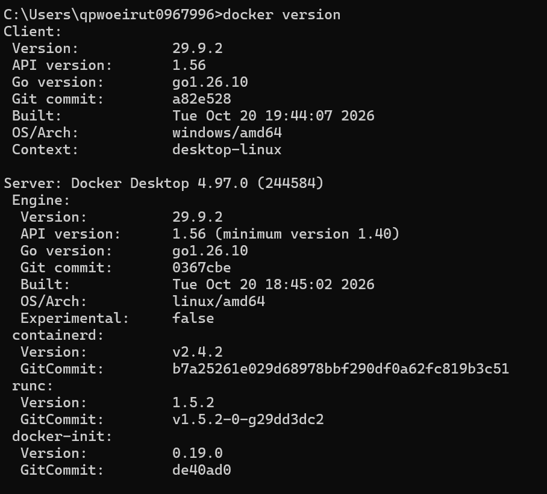
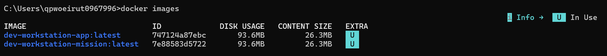
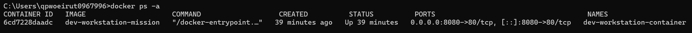
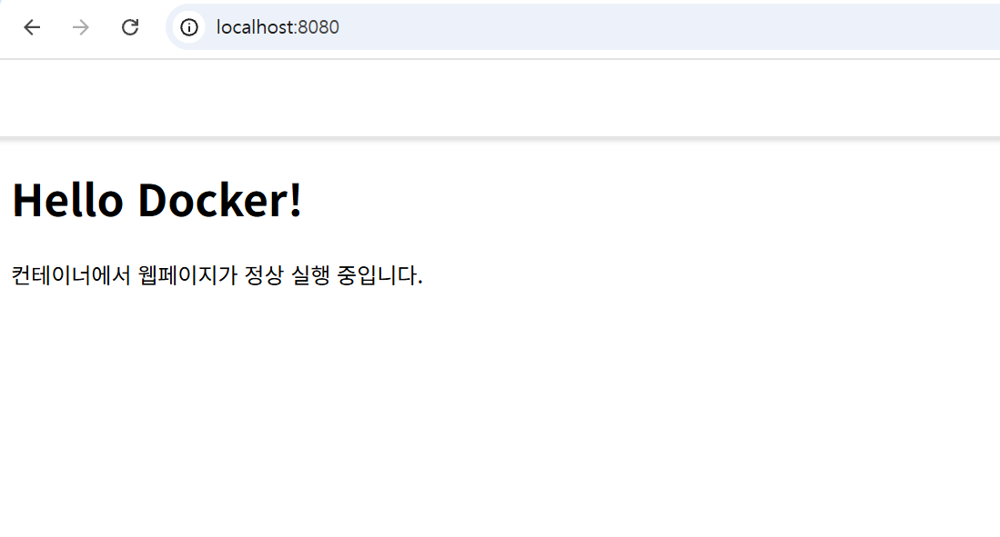
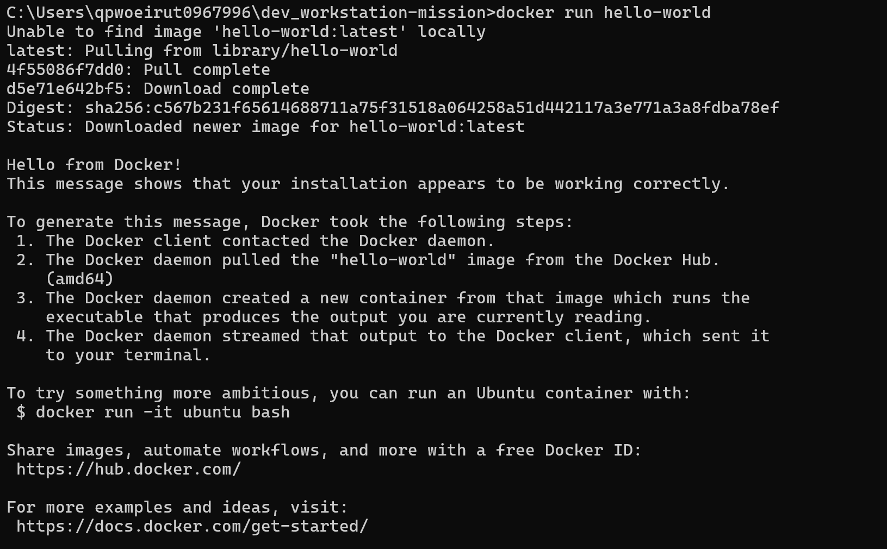

# dev_workstation-mission

## 1. 프로젝트 소개
터미널, Git, Docker를 사용하여 개발 워크스테이션 환경을 구성하고,  
정적 웹페이지를 Docker 컨테이너로 실행한 실습 프로젝트입니다.

---

## 2. 실행 환경
- OS: Windows
- Shell / Terminal: Windows CMD
- Docker Version: Docker version 29.9.2, build a82e528
- Git Version: git version 2.56.0.windows.4
- VS Code Version: 1.144.0

---

## 3. 프로젝트 구조

```text
dev_workstation-mission/
├─ app/
├─ docs/
├─ evidence/
├─ src/
├─ Dockerfile
├─ index.html
└─ README.md
```

---

## 4. 확인 명령어

```bat
docker version
docker images
docker ps -a
docker run hello-world
```

---

## 5. 증빙 자료

### 5-1. Docker 버전 확인
Docker가 정상적으로 설치되었는지 확인하기 위해 `docker version` 명령어를 실행하였다.

```bat
docker version
```



### 5-2. Docker 정보 확인
Docker Client와 Server가 정상적으로 동작하는지 확인하기 위해 `docker info` 명령어를 실행하였다.

```bat
docker info
```

출력 결과를 통해 Docker 환경 정보와 서버 상태를 확인할 수 있었다.


### 5-3. Docker 이미지 확인
생성되거나 내려받은 Docker 이미지를 확인하기 위해 `docker images` 명령어를 실행하였다.

```bat
docker images
```



### 5-4. 컨테이너 확인
실행 및 종료된 컨테이너 목록을 확인하기 위해 `docker ps -a` 명령어를 실행하였다.

```bat
docker ps -a
```



### 5-5. 웹페이지 접속 결과
컨테이너 실행 후 브라우저에서 `localhost:8080`으로 접속하여 정적 웹페이지가 정상 출력되는지 확인하였다.



### 5-6. Docker hello-world 실행 결과
Docker가 정상적으로 동작하는지 확인하기 위해 `hello-world` 이미지를 실행하였다.

```bat
docker run hello-world
```

실행 결과 `Hello from Docker!` 메시지가 출력되었으며, 이를 통해 Docker 설치 및 실행 환경이 정상 동작함을 확인하였다.


---

## 6. 결론
Docker를 활용하여 정적 웹페이지를 컨테이너 환경에서 실행해보았고,  
이미지 생성, 컨테이너 실행, 포트 매핑, 브라우저 접속까지 정상적으로 확인하였다.  
이를 통해 Docker 기반 개발 및 배포의 기본 흐름을 실습할 수 있었다.